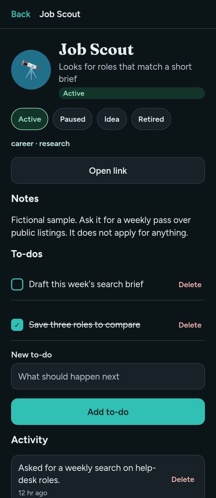
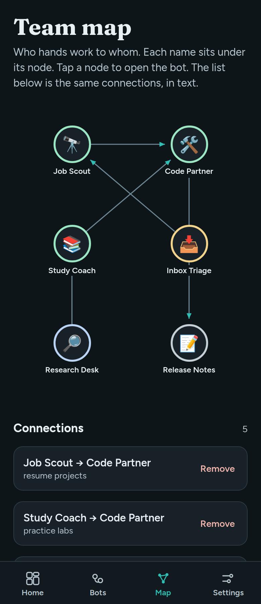
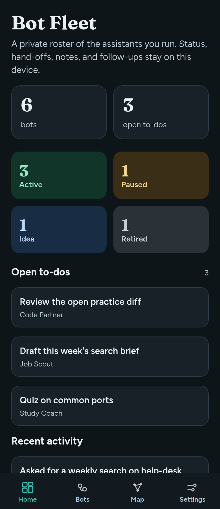

# Bot Fleet

[](https://github.com/Mercury101999/bot-fleet/actions/workflows/ci.yml)
[](https://github.com/Mercury101999/bot-fleet/actions/workflows/pages.yml)
[](LICENSE)

Bot Fleet is a phone dashboard for the AI assistants I run. I kept losing track of which one was active, which one was only an idea, and which one was supposed to hand work to another. This is one roster for that: name, role, status, notes, to-dos, and the hand-offs between them.

The main way to open it is the [live demo](https://mercury101999.github.io/bot-fleet/). It installs like an app and keeps working offline after the first visit. There is no account and no API. Nothing is read from Cursor or anywhere else. I type the bots in, and they stay on the device.

## Install it on your phone

Open [https://mercury101999.github.io/bot-fleet/](https://mercury101999.github.io/bot-fleet/) once while you are online.

**iPhone (Safari)**

1. Tap the Share button.
2. Tap **Add to Home Screen**.
3. Open Bot Fleet from the icon. After that first visit, it opens without a connection.

**Android (Chrome)**

1. Open the menu and tap **Install app** or **Add to Home screen**.
2. Open Bot Fleet from the launcher. It works offline after the first visit.

## What it looks like

The home screen opens in dark. It counts the fleet and lists open to-dos plus recent activity.


A bot keeps its role, status, notes, to-dos, and a short activity log.



The team map draws who hands work to whom, with each bot's name under its node. The same connections are listed underneath, with their labels.



Dark is the theme the first time you open the app. Light and System stay in Settings, and a theme you already picked is left alone.



## Features

- **Bot cards.** Name, short role, emoji, color, status (Active, Paused, Idea, Retired), tags, notes, and an optional http(s) link.
- **Roster.** Search, filter by status, and filter by tag. Open a bot, edit it, or delete it. Delete asks first and removes that bot's to-dos, activity, and connections.
- **Team map.** Directed hand-offs with an optional label such as "milestone updates" or "FYI". The diagram is a simple grid that stays readable on a phone, with the bot's name under each node. Tap a node to open the bot. The list under the diagram is the accessible version of the same links.
- **Activity and to-dos.** Each bot has a timestamped log and a checklist. Home shows open to-dos across the fleet and the latest activity.
- **Example fleet.** Six fictional assistants (Job Scout, Code Partner, Study Coach, and others) so the screens have something to show on a first run. They are samples, not real people or real accounts.
- **Backup.** Export the whole fleet as JSON, or paste a backup back in. A malformed file is rejected and the data on the device is left as it is.
- **Themes.** Dark on a first run. Light and System are still in Settings. A theme already saved on the device is not replaced.
- **Offline.** The installed web app loads from a service worker after the first visit.

## Tech stack

- Expo SDK 58, Expo Router, and strict TypeScript. The same project runs on iOS, Android, and the web. The web export is the primary target.
- AsyncStorage for the fleet. On the web that is local storage.
- A versioned on-device schema. Version 1 records (name, description, status, notes) migrate forward. A newer schema than this app understands is left untouched.
- Jest and React Native Testing Library.
- A static web export published to GitHub Pages at `/bot-fleet/`, with a web app manifest, maskable icons, and a service worker scoped to `/bot-fleet/`.

## Architecture

Screens in `src/app` render state. They do not own the rules. `src/lib/reducer.ts` creates bots, toggles to-dos, and deletes the links that pointed at a removed bot. `src/lib/migrate.ts` lifts an older save into the current shape and drops pieces it cannot read. `src/lib/transfer.ts` checks a JSON backup before anything is replaced. `src/lib/layout.ts` places the map nodes.

```
src/lib        fleet rules, storage, migrations, import checks, map layout
src/store      load and save that state on the device
src/app        Home, Bots, Map, Settings, bot detail, edit
src/components cards, the map, the bot form
scripts        icons and the service worker
```

`npm run build:web` exports the site and then `scripts/generate-sw.mjs` precaches it under the `/bot-fleet/` prefix. That is the path GitHub Pages uses for this repo. The manifest scope, the router base path, and the service worker all use that prefix. The production export omits Expo Router's `/_sitemap` route.

Bot and edit screens are static files (`/bot/?id=`, `/edit/?id=`) so a project site can serve them without a server rewrite.

## Run it

```bash
npm install
npm start          # Expo dev server
npm run web        # web, at /bot-fleet/
npm test           # unit tests and component tests
npm run typecheck
npm run lint
npm run build:web  # static site in dist/
```

CI on pull requests and on main runs the typecheck, lint, tests, and the web export. A push to main publishes `dist/` to GitHub Pages.

To try the export locally, serve `dist/` at `/bot-fleet/` (the HTML asks for assets under that prefix):

```bash
npm run build:web
mkdir -p /tmp/bot-fleet-site/bot-fleet
cp -R dist/. /tmp/bot-fleet-site/bot-fleet/
python3 -m http.server 4173 --directory /tmp/bot-fleet-site
# open http://127.0.0.1:4173/bot-fleet/
```

## Offline and the installed app

The service worker is registered at `/bot-fleet/sw.js` with scope `/bot-fleet/`. On install it precaches the shell, the route HTML, the scripts, the fonts, and the icons. After that, a refresh with no network still opens the app. The fleet itself is in local storage, so it is available offline too.

The first visit has to be online. Clearing the site data, or removing the home-screen icon and the browser data, deletes the fleet. There is no cloud copy.

## What I learned

A roster is more useful than a pile of chat threads when the assistants have jobs. The fields I actually look at are status, the open to-do, and who the bot is supposed to hand work to.

Shipping under `/bot-fleet/` only works if the router, the asset URLs, the manifest, and the service worker agree on that prefix. A dynamic id such as `/bot/abc` is not a file GitHub Pages can serve, so detail links are `/bot/?id=abc` and the static export can ship one `bot.html`.

I kept the screen tests on `fireEvent` and the rules in plain functions. The component tests check that search, the to-do checkbox, import errors, and the map list are wired up, and they stay fast on a GitHub runner.

## Privacy

Everything stays on the device. Bot Fleet does not send the roster, the notes, or the activity anywhere. There is no account. Uninstalling the app, or clearing the site data, removes what you saved.

## Roadmap

- Drag a bot to a remembered spot on the map.
- A reminder for to-dos that have been open for a while.
- Export or duplicate a single bot.
- A file you can copy between phones, still with no account.

## License

MIT. See [LICENSE](LICENSE).
